# Lab5Web
Belajar java script

Menampilkan Output — Menampilkan teks pada halaman HTML dan Console menggunakan JavaScript.

## Result

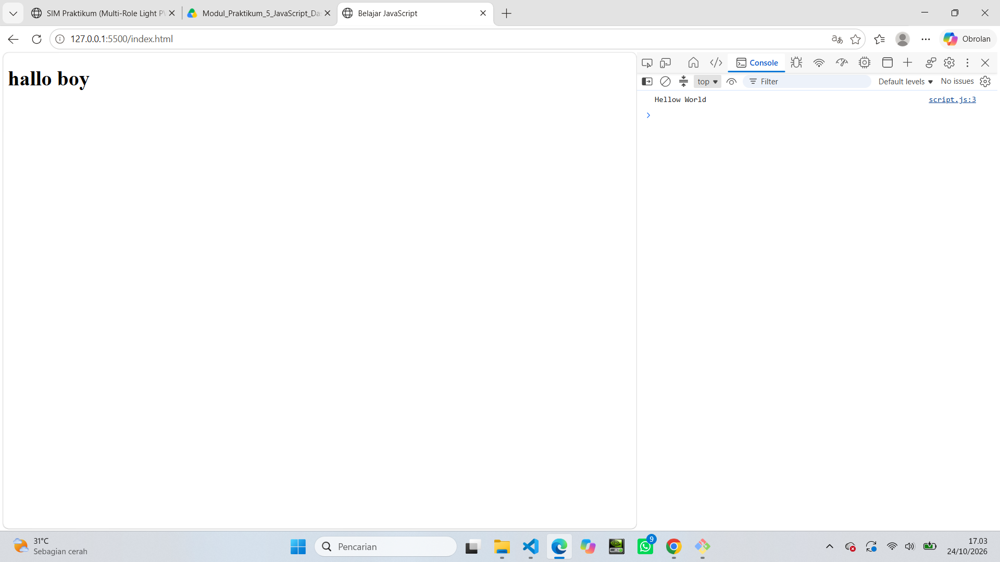

Alert dan Prompt — Menampilkan pesan dan menerima input dari pengguna.

## Result

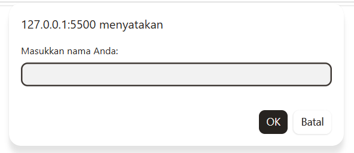

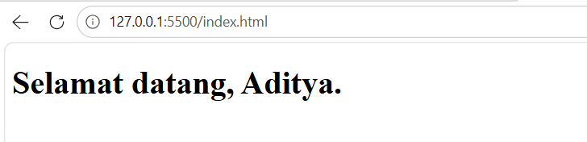

Function dan Operasi Aritmetika — Melakukan penjumlahan, pengurangan, perkalian, pembagian, dan modulus.

## Result

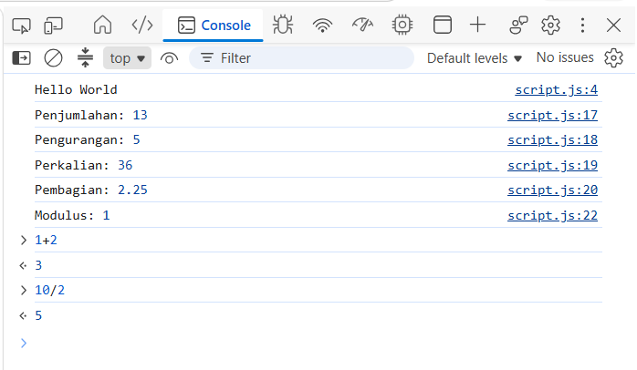

Percabangan If–Else — Menentukan status kelulusan berdasarkan nilai mahasiswa.

## Result

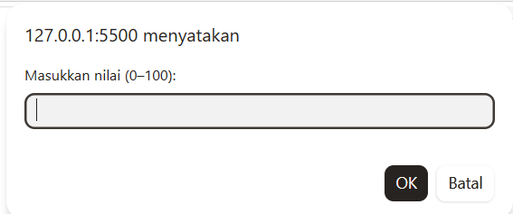

Percabangan Switch — Menampilkan nama bilangan berdasarkan pilihan angka 1–5.

## Result

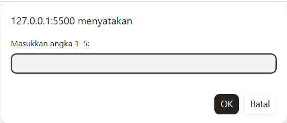

Form Bilangan Genap atau Ganjil — Memeriksa apakah input merupakan bilangan bulat genap atau ganjil.

## Result

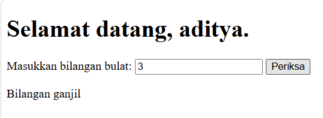

Mengubah Warna Halaman — Mengubah warna latar halaman menggunakan tombol.

## Result

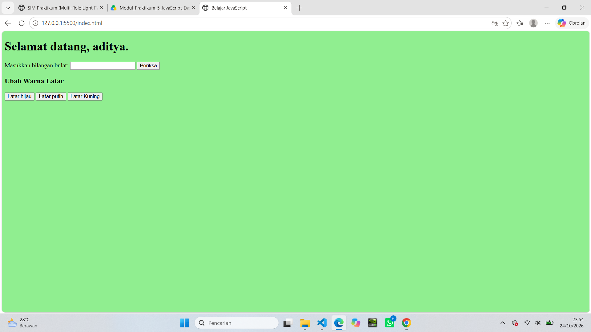

DOM dan Checkbox Menu Makanan — Menghitung total harga berdasarkan menu yang dipilih.

## Result

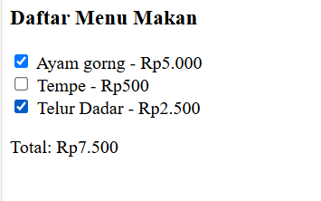

Mini Project: Kalkulator Nilai Mahasiswa

Mini project ini digunakan untuk menghitung nilai akhir mahasiswa berdasarkan tiga komponen penilaian, yaitu tugas, UTS, dan UAS.

Rumus perhitungan

Nilai akhir dihitung dengan bobot sebagai berikut:

Nilai tugas: 30%

Nilai UTS: 30%

Nilai UAS: 40%

Rumus:

Nilai Akhir = (Tugas × 0.30) + (UTS × 0.30) + (UAS × 0.40)

Kriteria predikat

Rentang Nilai

Predikat

85–100

A

75–84,99

B

60–74,99

C

50–59,99

D

Di bawah 50

E

Status kelulusan ditentukan berdasarkan nilai akhir:

Lulus: Nilai akhir ≥ 60.

Belum Lulus: Nilai akhir < 60.

Program juga melakukan validasi agar nilai tugas, UTS, dan UAS berada dalam rentang 0–100.

H. Cara Menjalankan Program

Unduh atau salin folder lab5_javascript ke komputer.

Buka folder tersebut menggunakan Visual Studio Code.

Pastikan file index.html dan script.js berada dalam folder yang sama.

Pastikan file HTML telah menghubungkan JavaScript menggunakan kode berikut sebelum tag penutup </body>:

Jalankan index.html menggunakan browser atau ekstensi Live Server pada Visual Studio Code.

Ikuti instruksi pada halaman dan masukkan data sesuai latihan.

Untuk melihat hasil console.log(), buka Developer Tools dengan menekan F12, kemudian pilih tab Console.

I. Pengujian Program

Pengujian dilakukan untuk memastikan setiap fitur berfungsi sesuai tujuan praktikum.

No.

Fitur yang Diuji

Skenario Pengujian

Hasil yang Diharapkan

1

Output JavaScript

Halaman dijalankan

Teks tampil pada halaman dan pesan muncul di Console

2

Alert dan Prompt

Memasukkan nama

Pesan sambutan ditampilkan

3

Operasi Aritmetika

Memasukkan dua bilangan

Hasil operasi ditampilkan dengan benar

4

If–Else

Memasukkan nilai 60 atau lebih

Status lulus ditampilkan

5

Switch

Memasukkan angka 1–5

Nama bilangan sesuai pilihan ditampilkan

6

Genap atau Ganjil

Memasukkan bilangan bulat

Jenis bilangan ditampilkan

7

Ubah Warna

Menekan tombol warna

Warna latar halaman berubah

8

Menu Makanan

Memilih atau membatalkan checkbox

Total harga diperbarui

9

Kalkulator Nilai

Memasukkan nilai tugas, UTS, dan UAS

Nilai akhir, predikat, dan status kelulusan ditampilkan

Catatan: Kolom hasil aktual dapat diperbarui berdasarkan pengujian yang benar-benar dilakukan.

## Result

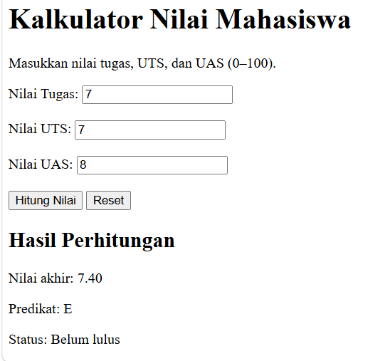

eksperimen mandiri mengubah latihan 3 dan mengonversinya menjadi number

## Result

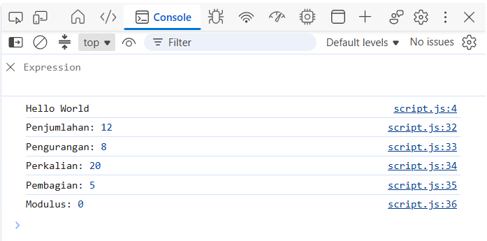

Membuat perulanagn untuk menampilkan tabel perkalian angka 7 dari 1 sampai 10

## Result

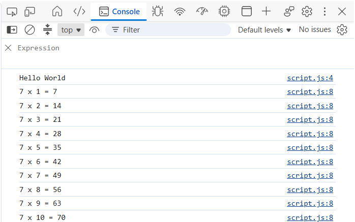

Membuat fuction cek angka genap 

## Result

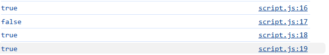
